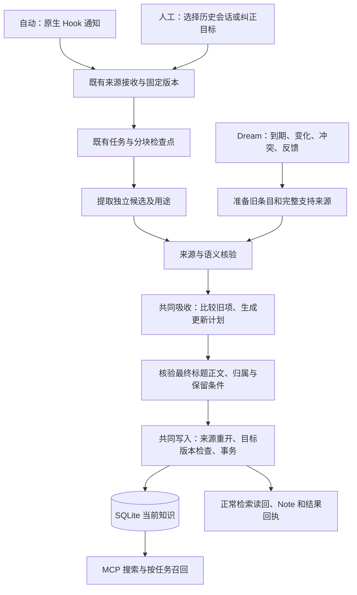

# 录入、更新与 Dream 架构收敛方案

2026-11-02 可用性与外部研究复核见 [既有调研纪要的本次增补](agent-memory-retrieval-research-2026.md#usability-review-20261102)。用户将 Lemma 吸收范围限定为召回解释和失败经验组织；本轮只完成分析与文档，不改变本合同写入、来源、准入和预算职责，不新增写入路线。下列 2026-10-21 自然失败仍是其原始时点证据，未被本轮源码检查或隔离测试覆盖成通过；建议路线与未执行事项仅在增补中维护。

## 最新真实首轮范围与归属验收：失败（截至 2026-10-21 22:04 UTC）

**本次 scope 为 FAIL，不以来源任务 completed 代替首轮质量通过。** 实际 root generation `2ceb86f8`、source job `50cd6434`、revision `dfce819d` 对应完整 87 轮来源。保留的原生首次返回仍把 User87 针对这一次执行、验收和接续范围的要求选成两条 rule，属于临时过选；后段判为 `session_only/no_write` 只证明未准入，不能接受首次选点。原 User70 的一次性关闭答复没有重选，只是有限正证据。

本轮零报告，不能将“没再混入旧 heartbeat-user 队列细节”当成正向说话人归属通过。独立完整来源语义审查发现，旧 p8 中有同一 assistant 独立支持的 driver/wake/coverage 核心，当前 comparisons 没有覆盖，这次也没有提取，存在实质漏义；不能靠不产报告避开其保留义务。前次已接受的两目标防重和完整正文读回继续保留，不在本轮重做或借用来覆盖失败。

安装仍为 `sha256:78c489bc81a61cd27351a7cc1f12ec49b61652749865dc54560985ca8b935877`，244 份实际 runtime 与 513 份 sealed Python 文件一致。当前知识 116、来源 206，均无新增；两条旧知识仅 `updated_at/verified_at` 刷新，十一条旧来源仅 `verified_at` 刷新。旧 124 份 Dream、338 份 handoff 的全部 payload 保持，当前分别为 125/339。新 Dream `ad38` 在 UTC22:04:13 执行结束，仍是 `failed/unresolved`：十个旧未决包括七份 pruned 来源和三项未获退休授权的 finite 条件；两项 applied 仅刷新验证。前次十二目标快照原样保留，不将数量变化表述为全库通过。

二十个受保护旧账户全部不变；本次同一自然账户 `cfcaaf42…` 四次 completed，reserved/unknown/failed 均为零，无 grants，累计 293,019 输入 / 7,981 输出 tokens、186.639586 原生请求秒。聊天工程及完整等待另计。46项实际机械核对通过；fresh 普通 installed MCP 已完整返回全部116条当前标题与正文，逐条全文相等，无index/continuation，证据为 `natural-first/terminal-actual-evidence.json` 与 `current-project-complete-request-result.json`。该读回不能逆转此次首轮失败。独立语义失败已定稿后，UTC22:10通过官方工具删除了本次有限自动跟进，实际deleteStatus=deleted；聊天未归档，见 `automation-deletion-receipt.json`。本段仅回写真实证据，没有再次派发模型、测试、数据库写入或安装。

证据目录：`.tmp/natural-source-closure-20261021/source-audit/first-selection-scope-author-fix/`；实际首轮为 `native-extraction-48168-0001.json` 与 `expanded-extraction-48168-0001.json`，终态快照为 `natural-first/snapshot-20261021T220420271364Z.json`，完整来源语义审计接续存于 `natural-first/independent-semantic-audit.*`。下列均为各自时点历史快照，保留原结论及限制。

## 修复首选点临时性与说话人边界（2026-10-21 21:51 UTC）

本次针对前次真实p1临时关闭答复仍过选、p8借heartbeat user机制补助手报告的两项首轮负证据。普通extract提示补齐关闭/不采纳与standing纠正、分句same-speaker语义支持合同，保finite继续条件、忠实转述和独立支持核心；当前对照、后段核验/存储及Dream不改。36项提示/运输与独立审查通过；实际安装244runtime/513源码和fresh指纹`78c489bc`一致，安装前后项目/全局账户保持。新真实Stop原始首轮和普通MCP读回仍待执行，不重做前次已通过两目标或五条读回；旧Dream12目标未决另留。见`source-audit/first-selection-scope-author-fix/`。

## 两项已提交目标的有限真实验收通过（2026-10-21 20:39 UTC）

实际安装/真实generation016da、新source736e/revision2d8f及首次原生8点同链；两目标澄清没有同义重提，独立审查未发现比较压掉实质新义。正常保存新三份报告原义/归属保留，终态fresh普通installed MCP返回两旧澄清与新三份完整正文；59实际核对通过。旧113/202/123/334全部payload及19历史账户不变，当前116/206/124/338；同一原自然账户10完成、679.489940原生秒、496089输入/30149输出，无活动/未知/失败/追加。

临时Hook过选及heartbeat user细节混归助手仍是首轮负证据；finaldefer/partial不能抹平。自然Dream已执行结束但旧12目标未决，failed/unresolved保持，新三条仅verification_refreshed。只关闭本次有限目标跟进，不以此宣称所有选点、归属或全库Dream通过。见`source-audit/repeated-extraction-fix/natural-first/terminal-actual-acceptance.json`及独立审查/终态MCP原始回包。

## 实际首次提取的有限接受（2026-10-21 20:34 UTC）

完整83轮来源、十项当前对照和首次原生返回逐项绑定。8个points未同义重提两条已提交目标澄清或旧76c修订机制，独立审查未发现比较压掉实质新义；三份实际新增报告完整来源/含义及普通installed MCP全文读回通过，39实际核对通过。原始选点仍有临时Hook过选及heartbeat user细节混归助手（实际partial未写入）的负证据，不能宣称全部8点或全库质量通过。正常同账户Dream尚在执行，终态待核。见`source-audit/repeated-extraction-fix/natural-first/`。

## 实际安装与交接（2026-10-21 20:21 UTC）

原监督器在其他任务自然结束后于20:20:19完成三owner备份/同步，244运行时、512Python封存和fresh installed指纹`4890198e`一致；安装前后项目与全局账户快照相等。原队列20:20:20选中root实际generation `016da4c2`，独立绑定20:16:59真实Stop，新sourcejob `736e0b31`/revision `2d8f4894`已出现并启用被动观察。当前只接受安装及真实交接，首提防重/新义保留/新结果MCP读回仍待核验，不重做旧已验收结果。见`source-audit/repeated-extraction-fix/installation-receipt.json`和`natural-first/`。

## 安装等待的实际原因（2026-10-21 20:14 UTC）

其他项目实际worker和原生调用持续推进，oiioii/kaiju账户从独立快照8/1、1/1 completed/reserved推进到13/1、2/1，当前无failed/unknown；不是仅凭旧launcher PID或lease心跳推断健康。62次30秒采样持续有重叠及新到任务，未见全局空闲，短空隙不排除。安装门先等全局空闲才拿exclusive；提前长持原exclusive会影响其他Dream续跑和新Stop。没有停止其他工作或改运行脚本；原有限监督器继续，安装/首次提取仍pending。见`source-audit/repeated-extraction-fix/install-wait-diagnosis.json`。以下日期是各自基线快照。

日期：2026-10-20。核对基线：`f4f73bc8332a78a6444ad8e0b01508b265d9659b`。

## 最新实际接续：首个新版自然 Stop 的有限验收（2026-10-21 16:35 UTC）

实际UTC16:10:50 final、原生Stop、generation `1b6fb47e`、新`bd9bf255`来源与完成的sourcejob同链；完整原始来源281,956字节/71交换，旧69交换是精确前缀。正常录入新增两份有独立机制/诊断价值的有界助手报告，普通安装版MCP全文逐字读回。15项独立内容核对与45项实际收据核对通过；临时Hook待答未重现，当次Hook配置候选最终session_only/defer。旧111正文保持，当前113知识/202来源。243源码安装与510Python封存仍一致，未再改运行时代码。

提取层仍重提两条已接受澄清，一份同源报告与旧报告重叠；最终defer/handoff未重复写入。因此只接受本样本的新增内容、临时范围准入和写入防重，不能称完全不重复提取。正常Dream execution completed但failed/unresolved，十项旧范围为七份已清理来源与三项未获退休授权的有限条件；两条新增不在未决中，四项applied只刷新验证。九次原生调用439,435输入/28,345输出tokens、716.311252原生秒，无活动/未知和追加，旧74账户全部不变。旧122Dream及327交接不变；五份旧sourcejob的正常队列hash变化独立列出，缺少旧完整bytes不反推具体改动。有限首事件跟进在核验后结束，未手动派模型或修改记忆来美化结果。详见 `source-audit/post-final-natural/actual-receipts-audit.json`、`independent-output-audit.json/.md`、普通MCP回包及最终关闭收据。以下均为当时的快照。

## 较早实际接续（2026-10-21 16:01 UTC）

自然录入将“等一次审计答复”误作长期未定设置的问题已修共同准入提示：持续未定配置或选择须有独立后续用途；单次待答、审计进度或“这句话是否要记住”的不确定本身不产生长期价值，同时保留真实未定设置、本轮有限条件和报告归属。提取、归纳、分类及普通/最终验证共用同一语义合同，schema、validator、storage和CAS不改。86项相关检查、Ruff和独立源码/driver审查通过，510份Python封存。UTC15:55:19仅同步provider一份owner并备份，243运行时文件一致，指纹`sha256:e7f9b0911f8bcaddd3fd12d9de641928620df197358144669a0bbddedb3fd083`。

真实安装版用误写时完整69轮原来源独立回查最终输出，不输入后来User70答复：supported但session_only/task_context，共同最终门禁阻止add并生成defer。正文、报告归属和声明条件未被删除以过门；111知识/199来源及旧job/run/handoff不改。原候选/evidence已正常清理，因此只用既有纯构建器、实际provider与共同bind/defer判断，没有重放已完成job或重建被删知识。证据见`source-audit/transient-uncertainty-admission-fix/`。这是真实最终准入门回查，尚不是新版的另一个原生Stop或完整自然提取/归纳闭环；后者沿原跟进等待本轮final后的真实事件。

本次额外只用原账户剩余一次调用，无追加：67,722输入/2,061输出tokens、64.204613实际原生秒。原修复账户累计70已知调用、八笔有限追加、5,719,820输入/311,653输出tokens、7,500.350823实际原生秒，活动/未知为零。下列来源审计与清理结果继续有效，均为各自时点证据。

## 较早实际接续（2026-10-21 15:30 UTC）

用户已明确最后那句 Hook 配置要求只针对当次安装，不另存长期约定。既有安装版保持五份澄清包各自完整原生来源和固定 target；复用137项，因验证时间刷新而重新核两处 covered 引用，再核最后 Hook 一处。实际两次原生调用完成，新来源审计 run 为 completed、零知识写入；原82窗口/140段、旧失败和所有费用保留。完整独立证据见 `source-audit/hook-scope-final-source/`。本轮没有更改或同步运行时代码，243份源码/安装文件及原指纹保持。

另一次真实自然 Stop 新增四条；独立审计接受两条旧话范围澄清和一条有界权威纠偏报告，拒绝一条等待 Hook 澄清的临时进度报告。该条已由普通 MCP 的既有 govern 删除，目标消失及其余三条完整正文均已普通 MCP 读回；其余111条、旧run/交接和全部模型账户不变。当前111知识、199来源。自然 Dream 的13个未决目标及 failed/unresolved 保留，不能把手动清理算自然闭环通过。见 `post-clarification-natural-audit.json` 和 `temporary-hook-progress-cleanup/`。

原明确修复账户现在69次已知调用、八笔有限追加、5,652,098输入/309,592输出tokens、7,436.146209实际原生秒；本次两次调用733,004 tokens、68.023677秒，无活动/未知用量。另一自然账户13次已知调用、624,725 tokens、1,145.471376秒，与旧未知账户分开保留。聊天工程与完整等待不在这些原生账本内。以下13:49及更早记录是历史快照。

## 较早实际接续（2026-10-21 13:49 UTC）

用户已明确旧验收的最后步骤、不加测、模型、出口与计费要求仅针对当时那轮。旧S49澄清与新答复各自保留原生版本，通过同一clarification owner的有序bundle逐项绑定；原前缀不替换，新项只解释三个精确pending范围。116项相关检查、Ruff和独立复审通过，509份Python封存；UTC13:39:58备份同步两个owner，243份源码/安装文件一致，当前指纹`sha256:377cad9a4991f65274833bc1501dc464c50a51cf97631a98adb366d35b167d84`。

实际安装版完成两次原生调用：三段旧验收条件分别判temporary并获独立supported；Hook配置原句仍unclear。原136项判断加本次三项共139项可复用，只余1段待核，当前正式run仍failed/unresolved，知识108条、来源195条不变。明确修复账户累计67次已知调用、七笔有限追加、4,920,715输入/307,971输出tokens、7,368.122532实际原生秒；本次没有新追加。见`source-audit/acceptance-scope-final-source/`。另一个13:15自然样本被本轮新答复录入造成的review lease丢失打断，其独立账户第5调用unknown保持；不算该自然样本通过，原因与操作纠正见`source-audit/new-natural-stop-1315-audit.json`。下列12:49/13:10阶段快照不覆盖这里的新结果。

- 原任务范围约束、16 条指定报告和原九条重复策略的归并，已有共同写入、独立来源/含义审查和普通 MCP 全文读回。已接受项不重做，证据在 `.tmp/automatic-repair-20261021/final-acceptance.json`。
- 原来源三个交接已实际新增两条、另一条 no-write，正常 MCP 全文读回完成。真实 06:47 native Stop 留下的四份报告也已沿原队列、自然账户和共同事务完成，并独立核验来源、含义及 MCP 全文。旧测试政策已由真实 Dream 精化为当时验证方式的有限决定并读回；另一次人工 MCP 更正用四份当前仓库证据纠正了旧心跳来源的权威误认，不能冒充自然录入。本项目目前 108 条知识、195 条来源。见 `.tmp/natural-source-closure-20261021/source-audit/handoff-completion/`、`natural-handoff-index-closure/independent-natural-audit.json`、`c7-scope-correction/`、`repository-authority-correction/independent-acceptance.json`。
- 剩余完整来源审计尚未接受。零点/非零点负审计均保留真实 observation 与未准入候选/evidence；续跑复用已核非提取判断，已提交点及已关闭交接须有共同事务/结果证明，未提交点保持 pending。用户对旧引用“当时测试”的澄清保存在另一份不可变原生来源，未回填旧原文，也未变成长久规则。
- 最新安装版四阶段实际调用复用了 133 项旧判断，未写知识；一条旧验收决定的三个范围仍真正 unclear，另一条候选的最终条件数组不等于原声明条件，严格拒绝。预算恢复、完整旧账与安全不写已获独立接受；不能把它写成完整来源通过。随后只澄清 add 提示的逐项同序绑定，保留完整来源/意义独立审查及严格 validator，旧无效票仍拒绝。25 条条件门禁、73 条 final/report 回归、Ruff 和独立实现审查通过。
- UTC12:49:14 在无其他活动 worker 的维护窗口备份并同步一个 owner，243 份源码/安装 Python 完全一致，指纹 `sha256:241a0255ebc1ddac2f757c59b0717778a04a6d65635ab67cc83143ddf258c7dc`。真实保留的 Hook 配置交接随后经共同 owner 完成 no-write：它只针对过去那次接入，不应成为长期规则；实际只调用一次 assimilation，没有执行 final-add 分支。该分支仍只有隔离与安装证据。原修复账户累计 65 次已知调用、七笔有限追加、4,281,639 输入/304,921 输出 tokens、7,254.212953 原生秒，active/unknown 均为零；旧账户、失败及来源均保留。旧验收决定是否仍约束当前修复，已向用户发出作用范围问题，未答不能推定。见 `source-audit/budget-resumed-source/actual-run-audit.json`、`add-condition-prompt-fix/`、`condition-handoff-completion/`。

- 已关闭交接的下一次只读准备，实际暴露了合法 `defer` 与已知最终拒绝注释的适配缺口。现已在原来源恢复 owner 修复：先严格核对原正式决策、同次拒绝收据、完整历史 state/hash、当前证据和闭合交接，再作仅内存的精确注释投影；不改原 evidence，不洗掉旧 failed。148 项相关检查与独立复审通过，508 份 Python 封存。UTC13:09:02 备份同步一个 owner 后，243 份源码/安装一致，当前指纹 `sha256:b8f3515d5ffe4f56c8a8303868710dc41a65439c626f259a97fb4176928135f6`。新安装版对真实旧来源的只读准备通过：136 项复用、4 段待核；其中三段是旧验收决定的作用范围，另一段是已关闭 no-write 的 Hook 范围。后者不重放同一提案，但仍须独立来源分类，不自动计为 covered。准备前后项目数据、四账户逐字节相同，模型调用为零。实际收据：`source-audit/final-reuse-delivery/remaining-readonly-preparation.json`；完整结果见 `source-audit/result.md`。

以下安装、隔离检查和待验收描述保留各自历史时期，不覆盖本节的新实际结果；完整来源审计仍待作用范围澄清，当前源码已在本机同步。

**状态：未发布源码收尾及隔离验收完成；自然运行和语义质量最终验收待完成。** 本文保留用户批准的整体设计及原始核对基线。最终封存源码的定向检查为 **667 passed / 54.75 秒**，424 个源码/测试文件检查前后哈希一致；命令、失败修复和具体范围见 `.tmp/grok-write-convergence-20261020/implementation-report.md`。这些证据不等于安装后的入口可用、自然模型语义质量或真实记忆清理完成。44 项是旧 v6 run 的历史未解决结果，不是当前全库剩余数、架构范围或总体质量代表。

此前源码实施阶段不安装、不改真实记忆或来源、不派发产品模型测试、Hook 或手动 Dream；后续用户已授权本机同步和继续修复，安装证据与新自然验收分别记录。Grok 工程执行因额度耗尽退出，已有失败与工程尝试保留；Codex 继续源码收尾，不将工程模型调用冒充零成本或产品验收。本轮没有重新授权模型测试。

后台任务跨来源处理、Dream 分片和重试，共用同一维护任务身份，默认最多 64 次原生执行、累计 3,600 原生秒、2,000,000 输入 token 和 128,000 输出 token。按原生终态实际 usage 累计，在后续调度前检查阈值；最后一次执行可能越过 token 阈值，且一次原生执行可能包含多条模型响应。未知用量阻止后续执行，不算零成本。这些阈值不限制返回上下文、完整用户等待或当前 Agent 整聊。只有显式设置 `task_model_budget.host_max_output_tokens` 才要求严格原生硬边界；宿主不支持或无法证明时，在 transport 前拒绝该严格模式。普通后台执行不以这个可选硬上限为前提。此修正的本机安装和可调度性已核对；自然语义验收仍需新收据。 当前 Agent 手动历史整理与纠正无需后台授权，继续执行同一来源/语义/事务合同。

以下第 1–12 节保留设计合同、实施顺序与验收目标；历史基线问题不应读成当前源码仍必然存在，也不应读成已通过真实验收。第 13 节说明当前公开判断参数与调用方式。

本机接续修复已于 2026-10-20 17:25 安装；717 项隔离检查通过，完整运行时指纹一致，真实配置可调度。完整自然与清理验收仍待本轮正常 Stop 后的新收据。详见 `.tmp/native-budget-closure-20261020/result.md`。

## 1. 目标与保留边界

用户可以正常聊天自动记忆，也可以说“整理这些历史会话”“继续上次整理”“纠正这条记忆”。三种请求共用完整来源、逐点核验、旧记忆比较、事务提交和正常检索读回。

保留五模块：0 来源与任务生命周期；1 提取；2 核验；3 吸收更新；4 召回使用。Review 与 Dream 仍为反馈能力。SQLite `knowledge_entries` 保持唯一当前知识权威；来源、任务、Note 保持各自已有存储职责；不新增图数据库、记忆库、策略服务、常驻服务或另一套批处理系统。

自动化依赖已有一次授权与项目覆盖策略；主动整理历史会话使用当前 Agent，不以后台 CLI 授权为前提，也不静默切换模型、宿主或执行方式。删除原文、删除当前记忆、生成摘要分别授权和报告。缺来源不构成删除理由。

## 2. 当前问题与责任归属

| 已核实的问题 | 当前实现位置 | 收敛后的责任 |
| --- | --- | --- |
| 临时进度、实验数字与可复用结论曾混合录入；有归属不等于有长期价值 | `autonomous/models.py`、`provider.py`、`worker.py` | 提取提出用途判断；核验检查其支持；吸收决定是否有必要改变当前知识 |
| 抽取候选与最终标题、正文之间可能增加义务或丢条件 | `worker.py::_verify_final_knowledge_scope`、`separated_assimilation.py` | 最终实际写入内容通过同一核验合同，来源核对与语义核验各自明确 |
| 新会话与旧报告更新曾在上层、存储层规则不一致 | `separated_assimilation.py`、`knowledge_assimilation.py`、`knowledge_store.py` | 比较决定归吸收；存储执行同一目标和归属合同，不再维护不同版本的许可表 |
| 报告标题由说话人与时间机械生成，Dream 报告精简又要求一个输出单元 | `source_report.py`、`knowledge.py`、`dream_assimilation.py` | 报告是证据归属；主题标题和独立知识条目另外表达，来源账户不等于主题身份 |
| Dream 有独立字面精简与校验路径，合同修复不断增多 | `dream.py`、`dream_assimilation.py` | 保留选题、续跑和旧条目适配；支持复杂更新时调用共同吸收与提交路径 |
| 整理跑完、内容未解决、执行失败在总状态中混在一起 | `dream_run.py`、`dream.py`、任务回执 | 分开执行进度和知识处理结果，仍显示未解决，不能通过换状态算验收成功 |
| 原基线手动批次内核尚在，公开 wrapper 却拒绝创建和续跑（源码已恢复，安装待验收） | `mcp/tool_handlers.py::_prepare_memory_review`、`manual_distill.py` | 恢复显式历史整理与续跑；自动日常不要求用户选批次 |
| 维护 CLI 和原生入口的人工/自动策略容易分歧 | `archive_distill.py`、canonical `hm` 和镜像 | 保留入口差异，共用来源、任务所有权和结果协议；归档 CLI 保持运维用途 |

这不是已经完成的全库审计。当前失败材料能够证明这些缺口，不能证明所有条目错误或新版语义质量已经可靠。

## 3. 外部参考怎样影响本次选择

以下针对本地固定版本，不表示上游最新版；具体固定提交及代码位置沿用[参考目录](reference-projects/index.md)和[写入核对](reference-projects/write-path-20261020.md)。

| 参考 | 本次采用 | 保留差异与不采用项 |
| --- | --- | --- |
| claude-mem `a90066f9cf82` | 会话记录、进度摘要与观察各有职责；持久任务先于投递；同事件精确重放 | 本项目已有来源、job、Note、当前知识；不复制 beta 的 Postgres/BullMQ，也不把 observation 等同已核长期事实 |
| Hindsight `b5d8439c8f1b` | 提取与 consolidation 分离；比较有限相关旧项；写前检查来源与目标；任务恢复有界 | 复用本地任务与事务，不复制分布式 worker；其流程也不自动证明语义无损 |
| Mem0 `38e47ac2619b` | 调用方范围、明确生命周期 API、按范围更新/删除 | 此快照默认提取后新增，不作为旧版 ADD/UPDATE/DELETE 吸收范例；不能用返回 ADD 替代落库读回 |
| Graphiti `4f62cfe7a2d5` | 区分事件时间、当前有效状态，保留新决定的适用范围 | 不引入图数据库或旧知识历史；旧事件晚导入不天然覆盖新决定 |
| Letta `5beb66e9981d`、Pi 文档固定版本 | 区分上下文压缩、会话连续性与长期知识；压缩有来源、预算与失败结果 | 不改宿主会话树、不用摘要替代原文，不把 compaction 当事实录入 |
| sqlite-vec、Tantivy | 派生索引的更新/删除与可恢复发布纪律 | 不改变 SQLite 权威，不先做检索引擎替换 |
| PrecisionMemBench、MemoryData、LoCoMo、LongMemEval、BEAM | 后续分别观察录入、跨会话更新、召回、拒答、故障和成本；失败保留 | 当前不运行模型评测，也不拿固定材料通过宣称全局可靠 |
| smartsearch | 证据不可用、降级和真正失败的区别 | 外部网页自动抓取尚无完整 owner，本阶段不夹带网络录入服务 |
| mattpocock-skills、vstash | 分别用于工作流职责边界、保留研究线索 | 不新增重复技能；论文不当已验证运行时方案 |

## 4. 一套核心，三个入口



Hook 不执行语义任务；Dream 作为无人值守入口继续调用所选宿主 CLI。手动 Agent 与后台 CLI 的语义执行者可以不同，必须遵守同一内容、目标和提交合同。图中的共同流程优先收敛进现有模块，不为图中每个框新建 manager、service 或协议。

## 5. 录入：同时检查真实性、长期用途与独立范围

在既有候选和核验模型中表达三个独立问题，避免把 `verified` 当作通行证：

1. **来源支持什么？** 用户决定、用户自述、仓库事实、助手归属报告分开；完整出处与原生说话人可重开。用户说“我用了某工具”并不独立证明工具的外部行为。
2. **以后为什么需要？** 持续决定、可复用方法、影响后续工作的约束或明确未定状态可以保留。寒暄、临时进度、失败尝试、单次数字通常进入会话 Note；无法判断时保留来源与待审原因，不自动变成长期待办。
3. **一条完整内容是什么？** 一条表达一个可独立查找和更新的结论，同时保留主体、适用范围、必要条件、因果限制和不确定性。不能按句号机械拆分，也不要求所有会话句子各形成候选。

提取只提出候选，不决定新增/替换。按主题检查完整来源中的最新支持结论，允许“完整读过但没有值得写入的内容”。会话覆盖与知识候选分别计量；长期价值仍需要语义判断，枚举、哈希与正则不能替代它。后台核验者及人工当前 Agent 都必须说明用途依据，运行时代码负责拒绝缺失/不一致的协议，不能声称由此保证判断正确。

用同一个小型核验结果表达支持、用途、范围与来源关系，逐步替换各路径重复字段。沿用 job workspace，不增永久语义标签库或逐句判断历史。

### 报告的内容与归属

`source_report` 继续表示某说话人在某时期、某来源中的报告，不升级成外部事实或用户批准。设计上允许同一来源账户有多条不同主题的独立报告，每条有具体主题标题、正文与自己的出处；渲染统一附上归属提示。

为此需要同时修改 `SourceReport` 渲染、`KnowledgeEntry` 一致性校验、吸收与检索消费者。只解除 Dream 的单输出限制会丢内容，不能作为实现。来源/说话人/时期相同只说明可比较，不能证明两条同主题或互相替代；不创建靠模型生成的永久“主题 ID”作为真值。

## 6. 更新：先找目标，再证明整个修改

共同吸收按既有项目标签与实际所有权取回相关当前项；全局搜索用于发现，写入严格按已解析 owner。候选召回无匹配不等于库中无相关条目；必要时展开精确主题、旧值或来源关系，仍不默认把整个库塞入每次模型输入。

| 情况 | 共同处理 |
| --- | --- |
| 没有相关旧项，候选独立、支持且有长期用途 | 新增 |
| 内容和范围完全一致 | 复用/确认；不新增同义副本 |
| 同一主题增加条件、纠正范围或有新决定 | 对明确目标更新，列出仍适用的旧条件及保留去向 |
| 新来源比旧来源更晚导入，但陈述时间更早 | 不仅凭导入时间覆盖当前决定 |
| 用户明确修改一个字段，其余不变 | 只改明确范围；保留未改字段、未定状态与原有约束 |
| 助手提议、用户明确决定、仓库执行事实 | 各自保留身份；没有证据不互相升格 |
| 多条旧项变为多条新项 | 一份计划内完整验证和事务提交；同一个前驱不能被两个独立修改点重复占用 |
| 报告跨说话人或跨来源账户 | 不自动覆盖；各自保留归属，阅读时可以关联，不改写为统一事实 |
| 不支持、冲突或长期用途不清楚 | 明确不写、待审或真实未完成动作；不伪装成已学会 |

最终核验覆盖**实际标题、正文、归属、所有目标及必要旧条件**，检查新增义务、遗漏限定和错误批准。证明绑定来源版本、候选/输出内容、目标版本与核验合同；内容不变才能复用完全相同的证明。哈希相等只证明内容相同，来源仍须按提交边界重开。只改标题也要核验新标题。

事务由现有 `knowledge_assimilation.py` / `knowledge_store.py` / `canonical_store.py` 所有。目标版本变化时停止本次计划、重读目标再比较；不能在旧计划上静默重试覆盖。各来源库与知识库不假装跨库原子：知识已提交而 Note/回执失败时，重试复用提交凭据补齐结果，不重复执行知识修改。

## 7. Dream：准备复核工作，复用核心修改

Dream 保留这些独立职责：根据来源变化、到期、冲突、重复或使用反馈选择目标；重开完整来源；按项目/所有权有限调度；持久检查点、续跑和复核到期状态。一个 Stop 通知既有会话处理后可以触发项目治理，但两类任务的执行、成本和结果分别报告。

共同核验与吸收负责实际刷新、精简、替换或删除。支持精简后的最终内容必须回到共同最终核验；原来的 `partial` 不能因为存在一段可保留内容就变成整条支持。旧 v7 字面证明仅用于原先精确操作，不冒充新普通录入证明；在共同替换路径验证完并迁移消费者后，删除冗余私有精简协议。

| 情况 | Dream 结果与再次执行条件 |
| --- | --- |
| 支持且仍有用，内容无需变化 | 确认并更新已有复核元数据 |
| 临时记录与持久结论混杂 | 准备可独立的输出和完整保留清单，经共同吸收、最终核验后一次替换；不能安全分开则保留待审 |
| 完全重复 | 绑定重复项与保留项版本，确认来源关系后共同事务去重 |
| 明确反证或确为无实质内容的临时记录 | 按现有严格删除合同处理；仅凭 `session_only`、日期久或缺来源均不足以删除 |
| 来源缺失、截断、当前不支持重开 | 保留当前条目与原因，继续正常召回；来源变化/到期才复查 |
| 模型/宿主/读取/提交失败 | 已有任务保存失败原因、阶段、已提交结果及可重试性，按原有预算退避 |
| 人工判断才能解决的冲突 | 进入可读待审；无新信息不重复消耗模型 |

复核去重键沿用条目内容、目标/来源版本和合同版本；新用户证据、实际版本变化或已配置到期可以解除等待。单纯又收到 Stop 不重跑所有未解决项。分片在持久检查点让出，不取消已发且仍在 provider 上限内的请求；取消、超时和未知用量仍如实记录。

执行已遍历与知识问题已解决分开呈现，例如“本轮遍历完成，仍有待审内容”。它不能替代全目标完成与独立读回，更不能把旧失败改成成功。沿用现有回执扩展兼容字段，不创建一套新的全局状态台账。

## 8. 正式保留手动历史整理

`hm` 保留日常查看/纠正/删除，同时增加明确的“整理历史会话 / 继续上次整理 / 查看整理进度”操作。用户用自然语言描述宿主、时间、主题或范围；Agent 用 `inspect_sessions` 只读盘点并将范围表达清楚。明确范围直接处理，含糊时只澄清无法确定的范围，不要求用户操作内部编号或逐条审批。

执行仍走已有流程：

1. `inspect_sessions` 返回可用来源及已处理状态；目录、项目存在与否不成为设备会话整理前提。
2. `prepare_session_distill(batch_sessions=...)` 固定选择，并在每个来源实际处理前完整捕获、绑定 revision。明确展示尚未捕获的选择，不把发现引用当固定快照。
3. 当前 Agent 在完整来源上执行共同提取、核验和吸收，`submit_distill_chunk` / `finalize_session_distill` 承接既有协议。
4. `batch_id` 只由 Agent 使用以续跑同一选择；停止的批次必须明确继续，失败项按明确重试处理；不能悄悄更换来源。`pause=true` 停在用户暂停状态；`continue_batch=true` 只恢复该暂停。来源、归属或 revision 失败的 stopped 保持停止，不能借 continue 转为活动；只读 `inspect_sessions` 不改状态；公开工具数量无需增加。
5. 默认保留原会话。已有结果能证明完成时复用；已处理旧会话的重新整理需要明确选择，绑定当前知识而不重复新增。

恢复 `tool_handlers.py` 里的创建/续跑分支，同时保留纠正目标与现有 job 审查。`ManualBatchStore` 只管理已冻结选择和进度，不变成第二个执行队列。手动和后台对同一来源 revision 共用 lease / 所有权，不能双方修改；后台正在执行时返回实际状态，先等待或明确接管，不能自动抢占。手动停止后不能被后台悄悄续跑；未来新 revision 的自动授权不由一个历史批次永久决定。

`maintenance archive-distill` 继续用于 Codex 归档运维，共用任务与提交核心，保持其后台执行授权；不能拿它绕过人工选择或假称用户入口已恢复。MCP schema、canonical `hm`、内部 distill 指令和仓库宿主镜像同批同步；已安装入口不随源码修改自动更新，本轮不做全局安装。只读 inventory 返回有限已有批次摘要、真实进度、inspect/resume/continue 参数及 none/unique/ambiguous 继续状态，不要求用户复制内部编号。

“压缩历史会话”在这里指提炼知识并生成可查摘要。宿主上下文 compaction 和原文物理删除不属于该操作的默认副作用。

## 9. 代码所有权与删除清单

| 责任 | 保留 owner | 修改或移除 |
| --- | --- | --- |
| 来源捕获、原生身份、固定版本 | adapters、transcript store、capture policy | 不用摘要、工具回显或宿主指令替代允许的原生对话；保留既有完整来源重开 |
| 选择、任务所有权、恢复 | session distill store、manual batch store、hook background | 去除 public wrapper 对人工批次的一律禁止；消除人工/后台对完成与重试的歧义 |
| 内容与归属 schema | `core/schemas/knowledge.py`、`source_report.py`、`evidence.py` | 报告主题与归属分开；合并私有类型白名单；已有数据先兼容读取 |
| 用途、来源与语义核验 | `autonomous/models.py`、`provider.py`、`commands/evidence_admission.py` | 把既有判断合成共同合同；删除各路径重复的私有准入判据，不另加规则引擎 |
| 旧项比较、计划、最终核验 | `separated_assimilation.py`、worker 内已有最终核验 helper | 由自动、人工与 Dream 共用；模型执行适配留在宿主层，核验 helper 不依赖启动另一后台 worker |
| 真正知识提交与读回 | `knowledge_assimilation.py`、`knowledge_store.py`、`canonical_store.py` | 抽出/复用已有提交边界，消除 Dream 的直接确认/退役差异；存储仍做硬校验 |
| Dream 选题与进度 | `dream.py`、`dream_run.py` | `dream_assimilation.py` 缩为旧条目/来源到共同计划的适配；重复动作模型、无消费者比较校验器和过时证明在调用点迁移后删除 |
| 输出及消费 | session notes、knowledge renderer、MCP handlers、hm 和镜像 | 报告标题、分页、归属与新状态全链同步，不靠回复包装伪造前序阶段成功 |

实施时对每个新增抽象列出可删除的旧实现；优先在现有 owner 内收敛。保留手动选择、后台调度和事务三个不同职责，不能为了少几个函数把它们耦合。任何仍有真实外部消费者的适配器先保留，查明后再删除；不为“未来也许需要”长期保留第二套默认路径。

## 10. 实施顺序与可交付结果

| 顺序 | 工作范围 | 交付及完成标准 |
| --- | --- | --- |
| 1 | 共同内容与更新合同 | 追踪一个新增、一个纠正、一个报告更新、一个旧混合条目；确定 final title/body、来源归属、条件保留和动作在现有 schema 的唯一表达，列出消费者兼容性 |
| 2 | 提取、核验与最终输出 | 新录入只产出有用途、可独立更新的条目；未录入内容仍有会话 review；完成共享最终核验 owner，报告兼容渲染，逐个消费者迁移 |
| 3 | 共同更新与提交 | 明确目标、精确重放、前驱版本检查、多旧多新提交和提交后恢复；先在普通会话/人工纠正走通，再让 Dream 使用 |
| 4 | 恢复手动历史入口 | 创建、盘点、完整来源、续跑、停止/恢复、失败处理和结果读回可用；同步原生入口，不要求后台开启，不吞已有批次 |
| 5 | Dream 收敛与删旧路径 | 用共同核验/吸收/提交处理治理；保留分段调度，补齐等待/失败分类和相同输入去重，删除被替代实现 |
| 6 | 部署与分范围验证 | 明确安装版本、宿主入口和实际执行者；隔离证据与真实自然运行分别核对。旧数据只读盘点后按授权维护，不随升级全库重写 |

每步都包含它的 schema/消费者/文档迁移，不能先把兼容性留到最后。步骤 4 依赖共同合同与既有提交 owner，但无需等待旧库全部清理；步骤 5 的复杂替换依赖步骤 3。旧 run 的 44 项作为步骤 5 的历史回归子集，不是当前剩余问题盘点；另保留普通用户决定、跨会话更正、报告、历史批次与无写入场景，避免只适配已知样本。

## 11. 验证、成本与停止条件

**此前源码交付阶段只使用临时库、fake transport 与已授权的定向静态/隔离证据，未进行产品模型测试、真实重整或安装。后续用户已授权本机同步和继续处理阻塞。** 该历史限制不覆盖后续明确授权，但不能制造事件冒充自然触发。既有自然运行回执可以只读分析，不能制造事件作为自然触发样本。

后续验收关注以下结果，不用代码存在或状态字段代替：

- 同一决定新增、独立召回、局部更正、再次召回，原有未改条件和未定状态保留。
- 临时进度与单次数字留在会话结果；有后续影响的约束或长期方案不因“助手报告”一律丢弃。
- 同源账户多主题报告有独立内容标题和精确归属，不相互覆盖，不升级事实。
- 手动历史整理在后台关闭时也可用；跨多会话可暂停续跑；人工/后台争用与新 revision 有明确结果。
- Dream 非空、多段续跑、旧混合内容精简、提交后失败恢复和独立 MCP 读回完整闭合；保留所有不能安全处理的条目。
- 缺来源条目正常可读，保持原因和到期状态；无新信息不因每次 Stop 重跑同一问题。
- 真实数据升级前后未授权条目不变；报告旧格式可读；索引与普通召回不出现已替换前驱。

成本记录沿用现有回执：每阶段调用、完整生命周期等待、输入/输出 token、失败/重试/未知用量分别计量。减少无变化复核、重复传输和完全相同的语义判断；完整来源捕获不等于每次把所有历史和全部知识再次发送给模型。保持有意的写前重开和独立读回。

实施在既有 executor dispatch 与 usage 回执处累计调用数、原生时间及 token，失败、重试和未知用量均进入原任务账目。后台任务跨来源处理、Dream 分片和重试，共用同一维护任务身份，默认最多 64 次原生执行、累计 3,600 原生秒、2,000,000 输入 token 和 128,000 输出 token。按原生终态实际 usage 累计，在后续调度前检查阈值；最后一次执行可能越过 token 阈值，且一次原生执行可能包含多条模型响应。未知用量阻止后续执行，不算零成本。这些阈值不限制返回上下文、完整用户等待或当前 Agent 整聊。只有显式设置 `task_model_budget.host_max_output_tokens` 才要求严格原生硬边界；宿主不支持或无法证明时，在 transport 前拒绝该严格模式。普通后台执行不以这个可选硬上限为前提。此修正的本机安装和可调度性已核对；自然语义验收仍需新收据。 `max_seconds` 不计队列间隔、完整生命周期等待或进程回收；本服务未测量/限制全部 ChatGPT 或 Agent 账单。预算扩展留在既有配置/调度 owner 内，不另建计费系统，不为节省用量牺牲完整来源或旧条件。

源损坏、跨 owner 目标、版本冲突、归属变化或无法证明保留完整时停止受影响修改，保留来源、任务和当前记忆。局部成功逐项报告，失败不得重命名为“全部完成”。

## 12. 选择、迁移与尚未证明的部分

比较过三种选择：继续扩展 Dream 私有规则（局部改动小但责任继续分叉）；采用新外部引擎/图存储（迁移与运行时成本大，不能直接解决现有语义问题）；**复用现有五模块，统一修改与提交合同**（本方案，需付出逐调用点迁移和报告兼容成本）。

依赖已核对：当前完整来源与 job 机制、normal assimilation transaction、最终核验、手动 batch 内核、20-tool surface 及原生 hm 镜像均已存在；其存在不等于新组合已经可用。外部网络证据抓取、上游在线刷新和宿主自身 compaction 不作为本阶段依赖或并行新增功能。

实施迁移顺序：先兼容读取和共同合同，后迁移写入调用点，再删除旧写路径；既有证明只适用于原绑定内容和合同，不能重新贴标签复用。默认不迁移真实内容；新的报告格式若需要存储变化，先验证旧读取与前后消费再启用。返回旧代码前检查其能否读取已写新格式，不承诺不兼容数据的无条件代码回滚；不得用恢复整个库覆盖用户后来新增记忆。保持当前不保存旧知识历史的边界。

仍须最终源码审查与真实证据解决：长期价值语义判断的稳定性、普通语言纠正的实际保留质量、检索漏配造成的重复、报告多主题的可读性、真正调用与等待成本、自然非空 Dream 及手动批次的完整用户路径。方案文档和静态审查均不构成这些结果的验收。

## 13. 当前 Agent 提交合同与高级兼容调用

### 正常手工整理：每点一次内容判断

2026-11-13 起，正常 `finalize_session_distill.memory_points` 在既有内容、来源引用和处置旁提交 `review`，示例如下；其他字段直接使用准备结果的模板。

```json
{
  "support": "supported",
  "use": "standing_decision",
  "reason": "用户明确要求今后发布先通过人工审核，并保留回滚凭据。",
  "conditions": ["人工审核", "回滚凭据"],
  "undecided_state": null
}
```

`conditions` 是最终正文中保留的必要条件短语；无条件才用空数组。`refine/replace` 在完整核对旧内容后增加 `preserves_meaning: true`，报告替换另增加 `same_topic: true`。这是一次完整内容判断；运行时将它绑定到自己持有的最终正文、来源、旧目标和版本，继续执行共同事务、回读和清理保护。正常路径不同时填写下面的高级判断，也不把重复抄写内部字段当成第二次独立语义验证。默认工作流见 [hm-distill](../code/tools/hm-distill/SKILL.md)。

### 高级兼容：显式 final scope 与既有 govern decide

工具数量保持 **20**。需要继续已有高级任务时，`finalize_session_distill` 顶层 `final_scope_judgment` 或 `semantic_review.final_scope_judgment`，以及 `govern_memory(action="decide").arguments.final_scope_judgment`，均接收对象。单个写入候选使用 `CandidateVerificationDecision` 形状 `{"points":[...]}`；多个候选使用 `{<runtime返回的candidate_id>:{"points":[...]}}`。在未提交正常 `review` 的此兼容路径中，显式 null、缺失、证明字符串或仅含 proof 的对象不能授权新写入。已完成任务的精确重放复用提交结果，不重新应用 caller 的替代计划。

| 字段 | 实际含义 |
| --- | --- |
| `candidate_index` | 此候选实际输出从零开始的索引，所有输出各覆盖一次 |
| `semantic_support` | `supported/partial/contradicted`；写入须 supported |
| `future_scope` | `durable/session_only/unclear`；写入须 durable |
| `source_use` | `standing_decision/reusable_knowledge/explicit_undecided/task_context/unclear`；后三者中 task_context/unclear 不准入 |
| `reason` | 8–1000 字符的实际支持与以后用途依据 |
| `scope_segments` | 按序完整覆盖最终 scope 文本；每段含 `text, source_use, future_scope, standalone, content_role, source_support` |
| `update_meaning_judgment` | refine/replace 须带完整替换判断：`relationship, predecessor_conditions, predecessor_statements, predecessor_versions, successor_statements, undecided_state, basis` |

普通输出的 scope 文本为实际 `title + "\n" + statement`，分段必须逐字拼回，不能仅检查正文。报告为 render标题、换行、render正文、换行和 `speaker|period|session_id|source_id|source_revision|exchange_indexes逗号连接`；不能遗漏账户归属。`relationship` 必须证明 `preserves_applicable_meaning`，旧正文和 `target_version` 来自已解析目标，successor 正文按实际输出顺序排列；`undecided_state` 可为 null。source support 与完整更新保留判断是不同义务。

以下是单候选单输出新增的完整收尾形状。`P/J/I/H` 分别替换为准备结果的 project_name、distill_job_id、用户 exchange_index 与 content_sha256；来源必须已经完整阅读、必要 chunk 已 checkpoint，并且确实明确支持此持续规则。编号和摘要由 Agent 取返回值，用户无需填写。该例不代表来源本身已经存在或可以跳过准备。

```javascript
const judgment = {points: [{
  candidate_index: 0, semantic_support: "supported", future_scope: "durable",
  source_use: "standing_decision", reason: "用户明确规定今后发布都需人工审核。",
  scope_segments: [{text: "发布审核\n发布前需人工审核。",
    source_use: "standing_decision", future_scope: "durable", standalone: true,
    content_role: "claim", source_support: "supported"}]
}]};
await finalize_session_distill({
  project_name: P, job_id: J,
  memory_points: [{content: "发布前需人工审核。", canonical_title: "发布审核",
    topic_path: ["发布"], evidence_basis: "user_statement",
    verification_outcome: "verified",
    verification_refs: [{kind: "user_statement", exchange_index: I,
      content_sha256: H, role: "user"}],
    assimilation_disposition: "add", assimilation_reason: "明确的持续发布约束。"}],
  semantic_review: {
    session_summary: "用户明确要求发布前人工审核，助手确认了此持续约束。",
    final_user_request: "发布前需人工审核。", final_outcome: "已完整审查该发布约束。",
    last_turn_status: "answered", contradictions: [], unfinished_work: [],
    evidence_status: "answered", promotion_decision: "promote",
    final_scope_judgment: judgment
  }
});
```

这里的 `finalize_session_distill` 表示实际 MCP 工具调用；通过工具环境使用实际返回的精确工具名与参数。已有非 distill 候选在 `govern_memory` decide 时把同一个 judgment 对象放入 `arguments.final_scope_judgment`，其余候选、验证证据、目标与 disposition 字段按原决定合同填写。删除不带该字段。`final_scope_judgment_required/final_scope_proof_string_rejected/final_scope_judgment_rejected/native_source_reopen_incomplete` 分别描述缺判断、伪证明、判断不满足合同与来源重开失败，均不代表知识已保存。

预算公开键为 `task_model_budget.max_calls`、`task_model_budget.max_seconds`、`task_model_budget.max_input_tokens`、`task_model_budget.max_output_tokens` 和 `task_model_budget.host_max_output_tokens`；显式值须为正整数。前四项未设置时使用 64 次原生执行、3,600 原生秒、2,000,000 输入 token、128,000 输出 token；第五项未设置时不启用严格原生硬上限。`harness-mem config set <key> <value>` 沿既有配置 owner 保存。fake transport 不证明真实宿主硬上限；普通累计阈值也不声称最后一次执行绝不超额。


公开报告复核的新增参数位于 `govern_memory.arguments`：`report_topic_judgment` 包含 `relationship/predecessor_title/successor_title/basis`；`report_split` 包含 `original_support="supported"`、typed `outputs` 与明确的临时 `omissions`。每个输出同时判断自己的主题、完整内容、必要限定与来源归属，所有输出经共同最终核验和一次事务替换，不能将部分支持升格或只留下被选中的几个方便输出。它们当前不在 `finalize_session_distill.memory_points` 的接收字段内，不用无效参数声称该入口已经支持拆分；旧 v7 字面编辑不作为此普通报告复核合同。

Dream 的普通旧条目来源发生明确更正时，核验响应可带 `replacement_items`、逐输出 `output_verifications` 与同一 `update_meaning_judgment`。旧条目的 source support 可以保持 contradicted，新内容单独通过完整 source/final scope；运行时不能把旧否定改成支持，也不调用第二次 assimilation 模型投票。临时库 numeric 7→30 天消费者保留该真实正例，最终定向 Dream 两文件 33 项通过；这是隔离证据，不是新自然运行验收。

## 14. 收尾实现边界（2026-10-20，未发布）

先前 Dream 来源复核合同为 `dream-source-recheck-v8`；当前 v9 的真实提案与独立核验接续见下一节。它将新的共同最终输出、完整更新判断与旧 v7 字面操作区分，旧合同的未解决指纹不能跳过本合同复核。v7 字面推导仍只能准备原精确操作，不能成为普通报告录入或最终语义判断。任何缺失、否定、不确定、旧版本或逐输出不一致的保留判断都保留旧条目；运行时不补造“条件均已保留”的结论。

普通联合替换可用 `replacement_target_ids` 选择同一有限比较批次内的已提供目标，必须包含自身。一个共同事务绑定全部旧正文与版本并提交全部新输出；其余被覆盖目标只在该事务成功后记为已处理。重叠提案保留待审，CAS 冲突不留下部分新条目。报告仍受账户、主题、完整限定和逐输出归属的独立约束。

自动来源处理和后续 Dream 分片保存同一维护任务预算身份；重新打开 provider、改运行目录或后续 Stop 不补充同一运行的额度。未实际调度的预算/能力拒绝不记成未知模型用量。Note 失败后的精确恢复复用已提交知识，并从同 job/session/source revision 的既有回执保留原调用账目，不借用另一任务的 provider，不重复写入或调用模型。当前可调度性与已完成回执的授权、隔离和 Note 证据分别呈现。

源码默认提供有限的排序比较集合，显式旧目标始终保留；同账户关系参与排序但不让整个账户绕过默认大小限制。回执区分实际总量、已提供量和扩展位置，词面未命中不证明旧知识不存在。`inspect_sessions` 只读展示暂停及异常旧批次；单个旧绑定异常不会遮蔽其他会话，也不会隐式恢复。

已删除无运行时消费者的私有 Dream 比较校验器、旧第二次 disposition 模型提示和重复比较 manifest。保留的 Dream 适配负责选题、来源、分片及旧字面推导；最终语义核验、更新保留与提交沿共同 owner。普通新增、人工纠正、报告拆分及治理均使用同一最终内容与目标版本边界。

此前封存交付为工作区源码、公开 schema/指南镜像和隔离检查，当时没有安装、真实历史重整、真实记忆修改、模型测试、提交或发布。后续本机同步记录见 `.tmp/grok-write-convergence-20261020/local-install-20261020T083537Z/summary.md`，该记录不验收本次预算修正。普通后台采用累计实际用量阈值；生产宿主严格输入/输出硬限额尚未证实，仅显式严格模式继续拒绝。人工当前 Agent 处理与普通召回可用。源码和隔离验收的最终命令、失败修复及源文件封存记录见 `.tmp/grok-write-convergence-20261020/implementation-report.md`；自然运行和模型判断质量仍待另行直接证据。


## 15. v9 的提案、独立最终核验与提交

v8 自然结果为 43 项完成遍历、11 项刷新、32 项未解决且无精简/删除。现有字段允许分类响应没有实际提案，故功能存在未形成执行闭环。v9 将分类与写入分开：原来源核验只给完整分类；现有 `provider.assimilate` 从完整重开来源、精确原条目和同组已核验邻居提出规范化更新；现有 `provider.verify` 独立判断实际最终标题、正文、报告归属及全部被替换前驱的适用含义；现有 canonical commit 检查来源、版本与原子提交并读回。

v9 分类中夹带旧 fused proposal/final 字段会让该点保持未解决。提案不是最终判断；缺失、否定、不确定、输出不完整或旧版本判断均不授权替换。报告单个长期输出也可保留，但原报告部分支持、未知或独立实质内容、必要限定缺失仍不能绕过。完全支持的报告确认也必须核对最终 render 文本和完整账户归属。

所有新阶段计入原维护任务累计实际用量。来源 checkpoint 仅留内容摘要、偏移与分类；提案核验后在同一原比较组完成提交才让出，避免长请求完成后在提交前丢弃方案而不断重复生成。原有限 watchdog 覆盖至多四个原生请求边界，各次请求仍使用既有宿主限制。回执保留逐阶段调用和输出、前驱版本与含义分类的摘要绑定，不另存正文历史。未额外派发产品模型测试或人为 Hook/Dream，完整自然清理验收仍须安装后的直接执行和真实读回。当前证据在 `.tmp/dream-proposal-closure-20261020/`。


## 19. 自然v12的逐字条件证明与v13合同澄清

自然v12的真实来源和非空分片运行已核对，执行遍历完成仍无实际内容精简，不能以execution completed或verification_refreshed验收。报告最终正票与前后文hash正确也不代替UpdateMeaningJudgment.covers要求的条件字面绑定；实际13个条件hash均不能匹配对应最终文本。v13在共同提案和最终核验同时声明既有准确合同，保留完整条件识别、字面定位、独立整次含义、来源归属与最终范围检查；不新增模型步骤，不放宽门禁，不清空条件，不直接改真实记忆。最终限定173项通过和本机同步只是继续自然验收的前提，实际旧内容精简/canonical/fresh MCP独立读回仍待完成。直接证据位于`.tmp/report-literal-projection-closure-20261020/`。


## 20. v14 的最终证明传输与有限修订

最终核验的原生schema只让模型表达独立含义判断和最终statement内的严格字符范围；冻结请求持有的前驱/版本/后继与逐字条件由适配器展开为原共同判断。范围不能创造独立语义证明，原完整库存、逐输出分区、报告归属和整次更新门禁保留。原始分类不产生字面编辑或最终授权。Hermes精确输出分支沿JSON escaping保留原字符。

共同Dream提案在安全原比较组内遇到规范化错误或最终拒绝，可在同任务原预算内合并为一次反馈修订。结构失败尚无最终判断，不能伪造成功payload；修稿完整重跑规范化/最终/含义门禁。反馈含完整原上下文和既有只读邻居，不能扩大原失败修改目标、重试已接受组或将非写入点变写入。跨组、未知身份/handle与全局覆盖错误保持失败。原提案失败且修稿不可用时，不能回退到初分类删除原条目。所有草稿与详细反馈仅临时存在，持久收据只存绑定、静态原因与原实际调用费用。

实际v12完整输出/分段重建和继续运行v13的qualifier缺失是本轮定位依据；原native响应未恢复的部分不称为逐字响应重放。隔离fixture、源码安装与真人自然清理分别验收，当前旧内容安全精简仍待直接证据。


## 21. v15 完整用户来源及独立解释的一致性

真人来源的v14非空自然任务确实完成4次替换；但独立审计确认一条丢掉完整原生User47中仍适用的“别再加一堆规则和验收流程”要求，质量验收失败。核验只收到原引用75/76/78，不能据其未提到就断言完整用户来源没有该要求。另一个新验收条目含heartbeat来源，不能算新的真人持久政策。16份旧混合报告只变更1份，其余15份未变。当前原run在12/23处保持continuing；原worker按既有lease-loss边界结束，自动跟进仍ACTIVE，原17次调用/426,055tokens/1,670.300129原生秒完整保留，active与unknown均0，没有改额度或账户。

v15沿既有证据owner先验证原exchange anchor和完整不可变revision/角色，再供应同版本全部已证明的user正文。新effective source locator保留anchor_sha256，content_sha256另绑定实际完整正文；普通重开与后代Dream均复核，报告仍沿原账户与角色。role=user仅证明捕获作者角色，不能推出真人批准、长期价值或外部真值。真实旧版本1955的只读演示已包含全部82个user exchange及47，未写入真实记忆，不能称为约束恢复。

多输出完整含义判断仅不再要求basis解释措辞逐字相同；关系、有序条件、未决状态、前驱全文/版本和后继全文仍逐项一致，每个输出独立覆盖实际整次更新，basis各自留hash。实际c653回执保留的其他字段匹配，解释原文未保存；解释差异属于排除其他分支后的推断，隔离复现不冒充原响应重放。所有来源/范围/报告/最终含义/CAS/canonical门禁保持。

最终封存552项120.09秒通过，440份Python源码/测试无漂移；Ruff和独立审查通过。UTC19:19:08备份同步6个owner，完整源码/安装指纹相同，调度ready，fresh安装MCP普通检索成功；新第3/4条正文可完整读回，不代表认可其持久语义。没有额外模型测试、人工Hook/Stop/Dream/worker或人工真实记忆修补。此前丢失约束仍未恢复，剩余旧内容精简也未验收，后续必须经正常共同语义owner、canonical及fresh读回独立确认。证据：`.tmp/report-literal-projection-closure-20261020/v15-source-context-and-meaning/`。


## 22. 原生巡检活动与真人待处理边界

原真人Stop在UTC19:22:42正常排队，巡检19:23:05写activity，原生heartbeat到19:23:08才落盘。旧标量谓词会误取消真人等待；本generation没有保存直接取消终态收据，具体取消结论属于原生时序/现有代码/请求消失与无新job的强因果重建。旧子会话来源失败不能混作本次主来源结果。

共享原生turn owner复核精确session/project/最新生命周期/metadata，精确AGENTS及environment仅中立；无turn不能借已完成或已可见的旧heartbeat。既有activity/ready owner在固定30秒内等待已绑定pending的正文，真人/混合/未知仍取消；同session OS锁和cancel水位避免后续巡检覆盖真人活动，ready瞬时取消决定不会被迟到正文反转。截止依赖原生record时间，不宣称独立测到append时刻；不新增队列、计时器、正文历史或读者侧取消写入。

90项定向2.15秒通过、442份Python封存无漂移；扩展检查8失败/42通过与实际旧安装基线完全一致，Ruff和独立审查通过。4owner分两次备份同步，最终UTC19:38:48完整源码/安装相同，新helper已纳入runtime fingerprint：sha256:7538d4a5a1257f66b2f49b2f1c09f055df21c337c8e653201905fdc0980093b2，Codex ready，fresh安装MCP普通检索可用。无额外模型/人工事件/退休请求重造/真实记忆修改/其他worker重启。原run仍12/23、17已知调用与额度不变，尚无新真人v15自然来源/内容验收，丢失约束未恢复，自动跟进保持ACTIVE。详见`.tmp/report-literal-projection-closure-20261020/native-idle-closure/`。


安装后UTC19:41:46已取得真实Stop排除收据：同turn精确native AGENTS刷新+heartbeat返回native_heartbeat_turn_excluded，background/spawned=false且无dispatch generation。独立核对31,782,043字节原生精确前缀、header/session/project、生命周期/metadata、两类user记录及完成回复hash，当前安装指纹匹配。这里只验收AGENTS加巡检的Stop排除；本样本没有environment追加，不验收真人等待请求保全，也不是新真人来源或记忆精简。原run12/23及17次原账户不变，丢失约束仍未恢复。证据：`.tmp/report-literal-projection-closure-20261020/native-idle-closure/native-agents-heartbeat-exclusion-acceptance.json`。

<a id="closed-history-reference-20261104"></a>

## 23. 完结历史整理的参考对照（2026-11-04）

当前用户选择以完结会话的吸收、历史清理和后续召回为核心，允许删减妨碍这些结果的复杂流程；活动安排与验收状态统一见 [roadmap 当前计划](roadmap.md#current-iteration-plan)。本次只读核对 `session-distill-skills` 的固定提交 [42fb1c0b26c2eeafe38104aae130c7e112f0d75d](https://github.com/manhua-man/session-distill-skills/tree/42fb1c0b26c2eeafe38104aae130c7e112f0d75d)，许可为 [MIT](https://github.com/manhua-man/session-distill-skills/blob/42fb1c0b26c2eeafe38104aae130c7e112f0d75d/LICENSE)，没有执行其安装或清理脚本。

参考的可取之处是：脚本准备完整来源和待核验材料，当前 Agent 核对代码／运行证据、按主题维护可读知识，再完成终审与清理。[准备 runner](https://github.com/manhua-man/session-distill-skills/blob/42fb1c0b26c2eeafe38104aae130c7e112f0d75d/shared/deep_distill_runner.py) 实际生成 PENDING 表；[终审](https://github.com/manhua-man/session-distill-skills/blob/42fb1c0b26c2eeafe38104aae130c7e112f0d75d/shared/distill_core/final_review.py)要求最终请求、结果、末轮状态、矛盾和未决事项。脚本执行完不等于语义处理完成。

以下八项是**根据当前用户选择提出的本项目最低验收标准**，不是声称参考已经全部做到：

| 标准 | 应直接观察的结果 |
| --- | --- |
| 发现与范围 | Agent 找到用户选定的完结会话；不要求用户维护目录、编号或命令参数。 |
| 完整来源 | 完整阅读冻结版本，保留作者和末轮纠正；长会话不以预览或前若干条候选代替覆盖。 |
| 核验与取舍 | 技术现状有当前代码／运行证据；用户决定保留适用条件；临时、过时和无依据内容有明确不写原因。 |
| 组织与更新 | 按实际主题整理，合并重复并更新旧说法，保留仍适用的条件和未定状态。 |
| 可读收尾 | 展示实存标题、正文及未完成事项，区分部分保存、无新增与全部完成。 |
| 续跑与变更 | 重用已完成结果；来源增长、版本冲突或证据变化时重审受影响内容。 |
| 物理清理 | 提交并读回后清理精确来源的中间文件；授权删除历史时再核对来源版本，保留活动、失败和未处理来源。 |
| 实际召回 | 在原始失败问题、陌生改写、跨项目和无答案任务中检查找回、正确使用、干扰与成本。 |

参考也有不能照搬的边界：[分块提取](https://github.com/manhua-man/session-distill-skills/blob/42fb1c0b26c2eeafe38104aae130c7e112f0d75d/shared/distill_core/deep_run.py)最终只返回前 24 项，[提取库](https://github.com/manhua-man/session-distill-skills/blob/42fb1c0b26c2eeafe38104aae130c7e112f0d75d/shared/deep_distill_lib.py)每块启发式提取最多 12 项，不能证明完整语义覆盖。[Codex 入口](https://github.com/manhua-man/session-distill-skills/blob/42fb1c0b26c2eeafe38104aae130c7e112f0d75d/adapters/codex-session-distill/bin/session-distill.py)的 `find_kb_hits` 只是词项交集提醒；`mark distilled` 保留原始历史，独立 `prune-raw` 才删除，但后者不先要求 distilled。其[中间文件 GC](https://github.com/manhua-man/session-distill-skills/blob/42fb1c0b26c2eeafe38104aae130c7e112f0d75d/shared/distill_core/adapter_common.py)吞掉删除异常，revision 删除失败也可能计为移除；不能用它的统计验收清理成功。文档中“packet 存在即已处理”的旧说法也与当前 revision／queue、完成后删除 packet 的实现冲突。

本项目吸收其当前 Agent 闭环和可读主题产物，复用既有 inspection／preparation／finalization 与 canonical 写入，不为完结历史处理附加 Hook 或后台模型前置条件。来源版本、目标版本、事务和普通检索读回保护仍有实际用途。上述对照是源码审查，不代表所有标准已经验收；后续实际范围与剩余召回失败统一见 [当前计划](roadmap.md#current-iteration-plan)。

2026-11-04 的一份真实 Oii 完结会话已经通过完整来源审查、65→16 主题合并、独立语义审计与全部普通检索全文读回。原始归档和同源八个已存原始 revision 已实际清理；重新打开存储后，16 条知识、4 份完整待办和 4 份 Note 保持不变。旧 revision 的已保存待办按自身完成来源与读回记录绑定保留，不等同于语义未吸收；两个此前已缺失且无可证继承的旧知识 ID 仍明确记录为历史缺口，不复活或冒称其当前有效。清理后的原 batch 通过已封存的 native 别名与 canonical source 身份分别核对，继续可检查、接续和重放清理结果。具体回执见 [清理后读回](../.tmp/completed-history-20261104/real-history/post-cleanup-readback.json)。这只验收该真实来源，未处理的全库历史、可靠召回、安装和自然宿主执行仍须分别取证。
